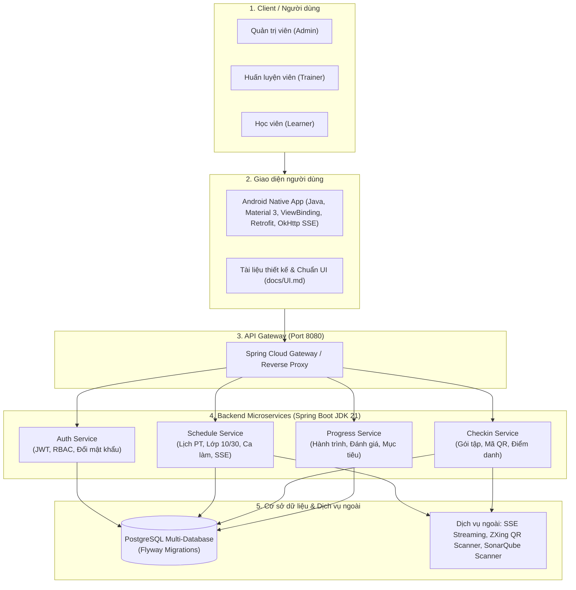

# MuayThai _Fitness Center

> Hệ thống quản lý phòng tập Muay Thai & Fitness toàn diện: Ứng dụng Android Java Native cho Quản trị viên, Huấn luyện viên, Học viên kết hợp Backend Microservices Spring Boot chạy trên nền Docker Compose & PostgreSQL.

[](https://github.com/emHung/MuayThai_Fitness-Center/releases/latest)
[-success?style=for-the-badge&logo=android)](https://github.com/emHung/MuayThai_Fitness-Center/releases/tag/v0.1.1)

> 📱 **Tải về bộ cài đặt APK theo phiên bản mới nhất:**
> - 📥 [Tải APK Tiêu chuẩn (app-debug.apk v0.1.1)](https://github.com/emHung/MuayThai_Fitness-Center/releases/download/v0.1.1/app-debug.apk)
> - 📥 [Tải APK Tailscale VPN (app-debug-tailscale.apk v0.1.1)](https://github.com/emHung/MuayThai_Fitness-Center/releases/download/v0.1.1/app-debug-tailscale.apk)
> - 📦 Xem toàn bộ lịch sử các bản phát hành tại [GitHub Releases](https://github.com/emHung/MuayThai_Fitness-Center/releases).

---

## Báo cáo hệ thống & Tiến độ bàn giao

> Dữ liệu tiến độ được đối chiếu trực tiếp từ mã nguồn và tài liệu nghiệm thu hiện hành của dự án: [PROGRESS.md](PROGRESS.md), bảng 59 yêu cầu [docs/NGHIEM_THU_V2_3.md](docs/NGHIEM_THU_V2_3.md), trạng thái thực thi [docs/DEMO_STATUS.md](docs/DEMO_STATUS.md) và bộ kiểm thử tự động [tests/acceptance.mjs](tests/acceptance.mjs).

* **Mốc nghiệm thu cấp cao**: **4/6 mốc đã hoàn thành** ([PROGRESS.md](PROGRESS.md)).
* **Yêu cầu chức năng chi tiết**: **50/59 yêu cầu (FR01–FR59)** đã có đầy đủ mã nguồn Backend, Migration và giao diện Android (~**85%**).
* **15% còn lại**: Đang triển khai tại 2 mốc cuối (Nghiệm thu v2.3 hoàn tất và Nghiệm thu thiết bị vật lý / đóng gói bản nộp).

```
+---------------------------------+---------------------------------+---------------------------------+
|       TIẾN ĐỘ BÀN GIAO          |    SITEMAP CẤU TRÚC HỆ THỐNG    |      CHỨC NĂNG ĐÃ HOÀN THÀNH    |
|   4/6 Mốc lớn · 50/59 FR (85%)  |                                 |                                 |
|        [█████████░] 85%         |       [ Client: 3 Vai trò ]     | [x] Xác thực & Phân quyền       |
|                                 |                 |               | [x] Quản lý Người dùng          |
| [x] Khởi tạo & Thiết kế         |                 v               | [x] API & Xử lý Dữ liệu         |
| [x] Phát triển Frontend/Backend |       [ Android Native App ]    | [x] Hệ thống Thông báo          |
| [x] Tích hợp & Kiểm thử API     |                 |               | [x] Cấu hình & Thiết lập        |
| [ ] Bàn giao & Triển khai       |                 v               | [x] Báo cáo & Thống kê          |
|                                 |       [ Spring Boot Gateway ]   |                                 |
|                                 |        /      |     |      \    |                                 |
|                                 |   [Auth] [Sched] [Check] [Prog] |                                 |
|                                 |        \      |     |      /    |                                 |
|                                 |       [ PostgreSQL Multi-DB ]   |                                 |
+---------------------------------+---------------------------------+---------------------------------+
```

### 1. Chi tiết Tiến độ & Cấu trúc



### 2. Danh mục chức năng đã hoàn thành

* [x] **Xác thực & Phân quyền**:
  * Đăng nhập chuẩn JWT, hỗ trợ 3 vai trò riêng biệt (`ADMIN`, `TRAINER`, `LEARNER`).
  * Cơ chế bắt buộc đổi mật khẩu tạm thời cho HLV trong lần đăng nhập đầu tiên.
  * Thu hồi phiên làm việc tức thời từ máy chủ khi đăng xuất.
* [x] **Quản lý Người dùng & Ca làm**:
  * Quản lý hồ sơ học viên, HLV, sinh mã hội viên tự động, khóa/mở khóa tài khoản.
  * Thiết lập và quản lý ca làm việc theo tuần cho từng huấn luyện viên.
* [x] **API & Xử lý Dữ liệu**:
  * Quản lý gói tập đa dạng: Gói PT cá nhân, Gói lớp 10 buổi (linh hoạt), Gói lớp 30 buổi (cố định).
  * Quy trình đặt lịch PT, HLV duyệt/từ chối, đề xuất đổi lịch học hai chiều.
  * Mở lớp học, đăng ký suất học, chuyển buổi học sang khung giờ khác.
  * Điểm danh bằng mã QR (ZXing) hoặc điểm danh thủ công có ghi rõ lý do.
* [x] **Hệ thống Thông báo**:
  * Thông báo lịch PT mới, yêu cầu đổi giờ, nhắc nhở buổi tập sắp diễn ra.
  * Truyền phát sự kiện thời gian thực (Server-Sent Events - SSE) trực tiếp đến ứng dụng Android.
* [x] **Cấu hình & Thiết lập**:
  * Đóng gói toàn bộ hệ thống bằng Docker Compose (`deploy/compose.yaml`).
  * Khởi tạo cơ sở dữ liệu và tài khoản demo tự động với script `deploy/init-demo.ps1`.
  * Quản lý cấu trúc bảng tự động bằng Flyway migrations.
  * Tích hợp kiểm tra chất lượng mã nguồn với SonarQube (`deploy/sonar.compose.yaml`).
* [x] **Báo cáo & Thống kê**:
  * Lịch sử điểm danh theo từng học viên và từng buổi tập.
  * Theo dõi số lượt tập còn lại của từng gói tập, lịch sử điều chỉnh lượt.
  * Đánh giá buổi tập, nhận xét của HLV và theo dõi mục tiêu luyện tập theo tháng.

---

## Các hạng mục còn thiếu để đạt 100% bàn giao (15% còn lại)

Dựa theo bảng nghiệm thu đối chiếu 59 yêu cầu tại [docs/NGHIEM_THU_V2_3.md](docs/NGHIEM_THU_V2_3.md), các hạng mục đang trong giai đoạn hoàn thiện gồm:

1. **Nghiệm thu phần cứng Camera QR thực tế (Hardware Testing - FR32)**:
   * Thử nghiệm quét mã QR trực tiếp qua camera vật lý của điện thoại Android tại quầy lễ tân (hiện tại kiểm thử chủ yếu chạy trên Android Emulator).
2. **Kiểm thử đồng bộ SSE nhiều máy đồng thời (Multi-device Sync - FR19)**:
   * Chạy thử nghiệm đồng thời 3 thiết bị thực tế (1 Admin, 1 HLV, 1 Học viên) để xác nhận việc cập nhật trạng thái lịch và thông báo diễn ra tức thì không bị nghẽn mạng.
3. **Đóng gói bản Release chính thức (Production Packaging)**:
   * Cấu hình tạo file APK có ký số bằng Production Keystore (thay cho Debug Keystore).
   * Thiết lập domain và chứng chỉ SSL/TLS (HTTPS) cho API Gateway trên server triển khai chính thức.
4. **Xác nhận các ca kiểm thử biên (Edge Cases - FR12, FR42)**:
   * Kiểm thử tranh chấp suất học cuối cùng giữa 2 học viên đặt cùng một giây.
   * Xử lý trường hợp khách vãng lai điểm danh (walk-in) vào lớp học đã kín chỗ.

---

## Chuẩn bị vận hành tại doanh nghiệp

Xem [hướng dẫn production](docs/PRODUCTION.md) để chuẩn bị database riêng, tạo tài khoản quản lý và build APK ký số qua HTTPS.

## Cập nhật Git hằng ngày

Ghi thay đổi và bằng chứng kiểm thử vào [nhật ký tiến độ](PROGRESS.md) cùng commit của ngày đó. Windows Task Scheduler chạy lúc **18:00 giờ Việt Nam** trên máy dự án khi tài khoản đã đăng nhập Windows. Lịch đẩy các commit trên `main` và bỏ qua lần chạy nếu GitHub đã có commit đó.

Dùng [push-daily.ps1](scripts/push-daily.ps1) với `-WhatIf` để xem trước. Nhật ký lượt chạy nằm tại `%LOCALAPPDATA%\MuayThaiFitness\DailyPublish\history.jsonl`.

---

## Chạy bản demo

Dùng PowerShell và Docker Desktop. Từ thư mục dự án, chạy các lệnh sau:

```powershell
.\deploy\init-demo.ps1
docker compose -f deploy/compose.yaml up -d --build --wait
Invoke-RestMethod http://127.0.0.1:8080/actuator/health
```

Gateway cục bộ lắng nghe tại `127.0.0.1:8080`. Flyway tự áp dụng migration. Trình khởi tạo tạo tài khoản demo khi database mới và lưu mật khẩu sinh ngẫu nhiên trong `deploy/.env`. Backend dùng JDK 21 trong Docker.

| Vai trò | Tài khoản demo | Biến mật khẩu trong `deploy/.env` |
| --- | --- | --- |
| Quản trị viên | `admin@example.test` | `DEMO_ADMIN_PASSWORD` |
| Huấn luyện viên | `trainer@example.test` | `DEMO_TRAINER_PASSWORD` |
| Học viên | `learner@example.test` | `DEMO_LEARNER_PASSWORD` |

*Lưu ý*: Huấn luyện viên dùng mật khẩu tạm phải đổi khi đăng nhập lần đầu. Quản trị viên thiết lập ca làm cho HLV trước khi mở lịch, xếp lớp hoặc đặt PT.

---

## Build và cài đặt Android

Dùng **JDK 17** và **Android SDK 36**. Mở thư mục `android` trong Android Studio hoặc chạy các lệnh sau qua PowerShell:

```powershell
$env:JAVA_HOME = 'C:\Program Files\Java\jdk-17'
$env:ANDROID_HOME = Join-Path $env:LOCALAPPDATA 'Android\Sdk'
Set-Location android
.\gradlew.bat :app:assembleDebug
$adb = Join-Path $env:ANDROID_HOME 'platform-tools\adb.exe'
& $adb install -r .\app\build\outputs\apk\debug\app-debug.apk
```

- Trên **Android Emulator**, APK debug mặc định dùng `http://10.0.2.2:8080/`.
- Trên **điện thoại kết nối USB**, bật gỡ lỗi USB và build với `'-PauthBaseUrl=http://127.0.0.1:8080/'`. Chạy `adb reverse tcp:8080 tcp:8080` trước khi mở app. Chỉ định `adb -s <serial>` nếu có nhiều thiết bị.
- Khi dùng máy chủ HTTPS, truyền `-PauthBaseUrl=https://<tên-miền>/` lúc build.

### Phát hành bản cập nhật Android

Khi mở hoặc quay lại ứng dụng, Android kiểm tra bản stable mới nhất trên GitHub Releases nếu đã qua một giờ kể từ lần kiểm tra trước. **Cập nhật ngay** bắt đầu tải APK và Android gửi thông báo để người dùng mở trình cài đặt. **Để sau** hoãn nhắc phiên bản đó trong 24 giờ.

1. Đặt tag theo dạng `vX.Y.Z`. Dùng cùng giá trị `X.Y.Z` làm `appVersionName`. Tăng `appVersionCode` cho mỗi bản phát hành và ký APK bằng cùng khóa với bản đang cài.
2. Build bằng `.\gradlew.bat :app:assembleRelease -PappVersionName=0.1.2 -PappVersionCode=3 -PauthBaseUrl=https://<tên-miền>/`. Đính kèm APK đã ký với tên `muaythai-release.apk`, sau đó xuất bản release ổn định.
3. Với bản debug cho emulator, tải lên `app-debug.apk`. Bản debug dùng địa chỉ `*.ts.net` tìm tệp `app-debug-tailscale.apk`. Nếu cần tên khác, dùng `-PappUpdateApkName=<tên-tệp>` khi build.

Người đang dùng APK ra trước tính năng này cần cài thủ công một lần. GitHub Release phải có thể truy cập công khai để ứng dụng kiểm tra phiên bản và tải tệp.

---

## Kiểm thử API tự động

Script `tests/acceptance.mjs` kiểm tra tự động toàn bộ 3 vai trò, xử lý tranh chấp điểm danh và đồng bộ lịch:

```powershell
$env:GATEWAY_PORT = '8180'
$env:CLASS_CALENDAR_CRON = '*/5 * * * * *'
docker compose -p khang-acceptance -f deploy/compose.yaml up -d --build --wait
$env:MUAYTHAI_TEST_URL = 'http://127.0.0.1:8180'
$env:MUAYTHAI_TEST_CALENDAR = '1'
$env:MUAYTHAI_TEST_RECOVERY = '1'
node tests/acceptance.mjs
docker compose -p khang-acceptance -f deploy/compose.yaml down
Remove-Item Env:GATEWAY_PORT, Env:CLASS_CALENDAR_CRON, Env:MUAYTHAI_TEST_URL, Env:MUAYTHAI_TEST_CALENDAR, Env:MUAYTHAI_TEST_RECOVERY
```

---

## Phân tích backend bằng SonarQube

SonarQube Community chạy trong Compose riêng và dùng cơ sở dữ liệu nhúng để phân tích cục bộ. Khởi động dịch vụ rồi mở [localhost:9000](http://127.0.0.1:9000). Lần đầu, đổi mật khẩu quản trị, tạo project riêng với key `muaythai-fitness-backend` và lấy token Project Analysis.

```powershell
docker compose -f deploy/sonar.compose.yaml up -d sonarqube
```

```powershell
$sonarToken = Read-Host 'Project Analysis Token' -AsSecureString
$env:SONAR_TOKEN = [System.Net.NetworkCredential]::new('', $sonarToken).Password
try {
    docker compose -f deploy/sonar.compose.yaml --profile scan run --rm scanner
} finally {
    Remove-Item Env:SONAR_TOKEN
}
```

Scanner chạy Maven `verify` rồi gửi báo cáo lên [dashboard backend](http://127.0.0.1:9000/dashboard?id=muaythai-fitness-backend). Xem Quality Gate sau khi máy chủ xử lý xong. Phạm vi lần quét là backend Java. APK được build và kiểm thử riêng bằng Gradle và ADB.

Để đo độ phủ từ bộ kiểm thử tích hợp, chạy `.\tests\coverage.ps1` trước khi chạy scanner. Script cần Node.js, Docker và `JAVA_HOME` trỏ tới JDK. Nó dùng stack thử nghiệm `khang-coverage`, mặc định ở cổng 8180, rồi ghi báo cáo vào `backend/target/coverage/acceptance.xml`. Có thể dùng `-Port` nếu cổng đã được dùng hoặc `-WhatIf` để xem trước thao tác.

---

## Sao lưu dữ liệu

Dùng `deploy/backup.ps1` để xuất PostgreSQL ra tệp SQL:

```powershell
$archive = Join-Path $env:LOCALAPPDATA 'MuayThai\Backups\demo.sql'
.\deploy\backup.ps1 -Destination $archive
```

Phục hồi bằng `psql -X -v ON_ERROR_STOP=1 -d postgres -f <tệp-sao-lưu>` trên cụm PostgreSQL mới.

---

## Cấu trúc thư mục

* `android/app/src/main`: Toàn bộ mã nguồn Android Java, layout XML và tài nguyên ứng dụng.
* `backend/`: Mã nguồn 5 microservices Spring Boot (`auth-service`, `schedule-service`, `checkin-service`, `progress-service`, `gateway`).
* `deploy/`: Cấu hình Docker Compose, file cấu hình mẫu và script khởi tạo.
* `docs/`: Đặc tả chi tiết [Đặc tả v2.3](docs/NGHIEM_THU_V2_3.md), [Hợp đồng API](docs/API.md), [Kiến trúc](docs/ARCHITECTURE.md), [Trạng thái bàn giao](docs/DEMO_STATUS.md).
