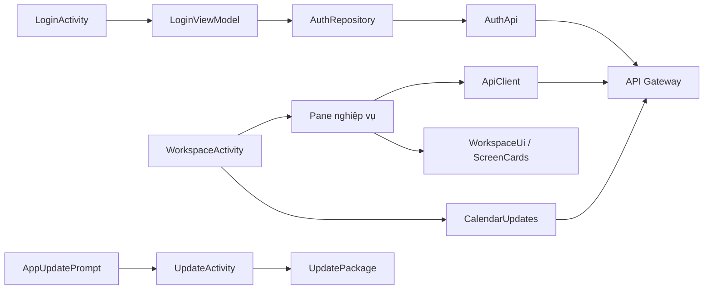

# Frontend Android: cấu trúc và trách nhiệm tệp

Frontend của dự án là **app Android Java/XML**, không có frontend React hoặc website để chạy bằng npm. Một APK phục vụ ADMIN, RECEPTION, TRAINER và LEARNER. Cài môi trường tại [hướng dẫn máy mới](../docs/SETUP_NEW_MACHINE.md), xem [sitemap](../docs/UI.md) và [hợp đồng API](../docs/API.md).

## Cây thư mục

```text
android/
  app/build.gradle                  SDK, dependency, phiên bản, endpoint, cấu hình ký
  app/src/main/
    AndroidManifest.xml             Quyền, activity, FileProvider
    java/vn/muaythai/app/            Logic màn hình và gọi API
    res/layout/                     Khung màn đăng nhập và workspace
    res/drawable/                   Icon vector, logo, nền thông báo
    res/values/                     Nhãn, theme, màu, kích thước
    res/xml/update_paths.xml        Giới hạn thư mục chia sẻ APK cập nhật
  app/src/debug/                    Manifest và ngoại lệ HTTP cục bộ khi debug
  gradle/wrapper/                    Gradle wrapper, không xóa file JAR
  third-party/                      Nguồn và giấy phép Remix Icon
```

`build/`, `.gradle/`, `local.properties`, APK và keystore là dữ liệu máy/build, không đưa lên Git. Các lớp `R`, `BuildConfig`, `ActivityLoginBinding`, `ActivityWorkspaceBinding` được sinh khi build, không sửa trực tiếp.

## Luồng chạy và ranh giới



Đăng nhập dùng ViewModel/Repository. Workspace hiện dựng màn bằng các Pane Java và XML khung, **không dùng Fragment cho từng tab**. `WorkspaceActivity` giữ phiên trong tiến trình, điều hướng và callback API; sau khi tiến trình mất cần đăng nhập lại. Không mô tả đây là hệ thống tự khôi phục phiên bền vững.

## Từng tệp Java dùng để làm gì

`HiddenItems.java` lưu lựa chọn ẩn buổi/yêu cầu đã kết thúc theo ID tài khoản trên thiết bị. Không xóa dữ liệu server; có hoàn tác và hiện lại danh sách. Đổi thiết bị hoặc xóa dữ liệu app không giữ lựa chọn ẩn này.

Tất cả đường dẫn ở bảng tính từ `app/src/main/java/vn/muaythai/app/`.

| Tệp | Trách nhiệm |
| --- | --- |
| [LoginActivity.java](app/src/main/java/vn/muaythai/app/LoginActivity.java) | Gắn form đăng nhập/đổi mật khẩu tạm với ViewModel, xử lý inset và thông báo kết nối/cập nhật. |
| [LoginViewModel.java](app/src/main/java/vn/muaythai/app/LoginViewModel.java) | Trạng thái form, kiểm dữ liệu và điều phối đăng nhập/đổi mật khẩu. |
| [AuthRepository.java](app/src/main/java/vn/muaythai/app/AuthRepository.java) | Gọi xác thực, trả kết quả cho ViewModel. |
| [AuthApi.java](app/src/main/java/vn/muaythai/app/AuthApi.java) | Retrofit contract và kiểu dữ liệu cho xác thực. |
| [ApiClient.java](app/src/main/java/vn/muaythai/app/ApiClient.java) | HTTP nghiệp vụ, Authorization, timeout và phương thức GET/POST/PUT/DELETE. |
| [Jsons.java](app/src/main/java/vn/muaythai/app/Jsons.java) | Đọc/chuyển JsonElement, tạo body và xử lý dữ liệu JSON chung. |
| [WorkspaceActivity.java](app/src/main/java/vn/muaythai/app/WorkspaceActivity.java) | Phiên, tab theo quyền, lịch sử màn, điều phối request/loading/lỗi/xác nhận. |
| [WorkspaceUi.java](app/src/main/java/vn/muaythai/app/WorkspaceUi.java) | Widget cơ bản: label, field, action, icon, card, chọn ngày/giờ và chuyển dp. |
| [ScreenCards.java](app/src/main/java/vn/muaythai/app/ScreenCards.java) | Hero, section, lưới thao tác, menu, empty state; không giữ nghiệp vụ. |
| [ScreenHeader.java](app/src/main/java/vn/muaythai/app/ScreenHeader.java) | Metadata tiêu đề, mô tả và icon cho các màn. |
| [DirectoryPane.java](app/src/main/java/vn/muaythai/app/DirectoryPane.java) | Danh bạ/hồ sơ, quản lý tài khoản, thông tin cá nhân và đổi mật khẩu. |
| [HiddenItems.java](app/src/main/java/vn/muaythai/app/HiddenItems.java) | Ẩn mục đã kết thúc theo tài khoản trên thiết bị, hoàn tác và hiện lại; giữ nguyên dữ liệu server. |
| [SchedulePane.java](app/src/main/java/vn/muaythai/app/SchedulePane.java) | Lịch ngày/tuần, chi tiết buổi, đặt PT và đầu vào lớp nhóm. |
| [ClassPane.java](app/src/main/java/vn/muaythai/app/ClassPane.java) | Biểu mẫu, chi tiết và thao tác quản lý lớp 10/30. |
| [PlanningPane.java](app/src/main/java/vn/muaythai/app/PlanningPane.java) | Ca làm, khung đóng và đề xuất/thay đổi lịch. |
| [PtSlotGrid.java](app/src/main/java/vn/muaythai/app/PtSlotGrid.java) | Theo dõi ngày đã chọn, tự tải giờ PT, bỏ phản hồi cũ và hiển thị trạng thái khả dụng/đang chọn. |
| [WeekSelector.java](app/src/main/java/vn/muaythai/app/WeekSelector.java) | Dải chọn ngày trong tuần; chuyển ngày cho SchedulePane lọc dữ liệu thật. |
| [CalendarUpdates.java](app/src/main/java/vn/muaythai/app/CalendarUpdates.java) | Kết nối sự kiện SSE và vòng đời tải lại lịch. |
| [PackagesPane.java](app/src/main/java/vn/muaythai/app/PackagesPane.java) | Cấp/xem gói, lượt/hạn và QR từng gói. |
| [AttendancePane.java](app/src/main/java/vn/muaythai/app/AttendancePane.java) | Camera/nhập mã, xem trước/xác nhận điểm danh, lịch sử và hoàn lượt theo quyền. |
| [PortraitScanner.java](app/src/main/java/vn/muaythai/app/PortraitScanner.java) | Activity camera ZXing cấu hình hướng dọc. |
| [ProgressPane.java](app/src/main/java/vn/muaythai/app/ProgressPane.java) | Nội dung buổi, đánh giá và mục tiêu/hành trình học viên. |
| [OperationsPane.java](app/src/main/java/vn/muaythai/app/OperationsPane.java) | Hộp thư/thông báo, chăm sóc và nhắc đánh giá. |
| [ImagesPane.java](app/src/main/java/vn/muaythai/app/ImagesPane.java) | Tải avatar có xác thực, chọn ảnh, xem trước, upload/xóa có xác nhận. |
| [ConnectivityNotice.java](app/src/main/java/vn/muaythai/app/ConnectivityNotice.java) | Quan sát mạng và hiện thông báo mất mạng/nối lại, mở cài đặt mạng. |
| [AppUpdatePrompt.java](app/src/main/java/vn/muaythai/app/AppUpdatePrompt.java) | Kiểm tra GitHub Releases, chọn asset theo build, nhắc ngay/để sau và chuyển sang màn tải. |
| [UpdateActivity.java](app/src/main/java/vn/muaythai/app/UpdateActivity.java) | Theo dõi DownloadManager, tiến độ/thử lại/hủy, quyền cài và mở trình cài Android. |
| [UpdatePackage.java](app/src/main/java/vn/muaythai/app/UpdatePackage.java) | Kiểm package, phiên bản/code mới, chữ ký và SHA-256 nếu release cung cấp. |

## XML và cấu hình

| Tệp/nhóm | Dùng khi nào |
| --- | --- |
| [activity_login.xml](app/src/main/res/layout/activity_login.xml) | Sửa bố cục form đăng nhập và mật khẩu tạm. |
| [activity_workspace.xml](app/src/main/res/layout/activity_workspace.xml) | Header, vùng nội dung, loading và thanh tab; nội dung nghiệp vụ dựng trong Pane. |
| [theme.xml](app/src/main/res/values/theme.xml) | Theme dùng chung và màu theo vai trò; `values-v27/theme.xml` tùy biến theo API. |
| [dimens.xml](app/src/main/res/values/dimens.xml) | Kích thước dùng chung, gồm khoảng cách hai nút ảnh 16dp. |
| [slot_colors.xml](app/src/main/res/values/slot_colors.xml) | Màu trạng thái lưới giờ PT. |
| [strings.xml](app/src/main/res/values/strings.xml) | Nhãn/thông báo dùng tài nguyên. Một số nhãn nghiệp vụ vẫn nằm trong Java. |
| `res/drawable/ic_*.xml` | Icon Remix dạng vector; không thay bằng nhiều bộ icon khác nhau. |
| [AndroidManifest.xml](app/src/main/AndroidManifest.xml) | Activity không export trừ launcher; quyền mạng/cài cập nhật và provider không export. |
| [debug manifest](app/src/debug/AndroidManifest.xml), [local_network.xml](app/src/debug/res/xml/local_network.xml) | Ngoại lệ HTTP cho emulator/USB chỉ ở debug. |
| [update_paths.xml](app/src/main/res/xml/update_paths.xml) | Chỉ chia sẻ thư mục APK cập nhật; không mở toàn bộ bộ nhớ app. |
| [build.gradle](app/build.gradle) | `authBaseUrl`, `appUpdateApkName`, `appVersionName`, `appVersionCode`, dependency và biến ký release. |
| [settings.gradle](settings.gradle), [gradle.properties](gradle.properties) | Module/repository và tùy chọn Gradle. |
| [third-party/README.md](third-party/README.md) | Nguồn icon và giấy phép phải giữ trong repository. |

## Khi thêm hoặc sửa chức năng

1. Chốt contract ở backend và [API.md](../docs/API.md), phân quyền ở server.
2. Đặt UI trong Pane sở hữu nghiệp vụ; widget dùng lại đưa vào WorkspaceUi/ScreenCards. Không thêm logic mạng vào widget.
3. Khai báo metadata/đường điều hướng ở ScreenHeader và WorkspaceActivity nếu thêm màn/tab.
4. Kiểm dữ liệu form, loading, lỗi, trạng thái rỗng, quyền theo vai trò và cỡ chữ lớn. Xem component dài như tín hiệu cần review, không tách máy móc.
5. Chạy `:app:assembleDebug :app:lintDebug`, thử luồng tương ứng trên emulator/điện thoại. [Danh mục kiểm thử](../docs/TESTING.md).

Endpoint nằm trong BuildConfig lúc build; không có màn đổi server trong app. APK debug build trên máy khác mặc định dùng khóa khác nên không tự cài đè chuỗi APK hiện tại. Xem [cài máy mới](../docs/SETUP_NEW_MACHINE.md) và [luồng cập nhật](../docs/IN_APP_UPDATE.md).
