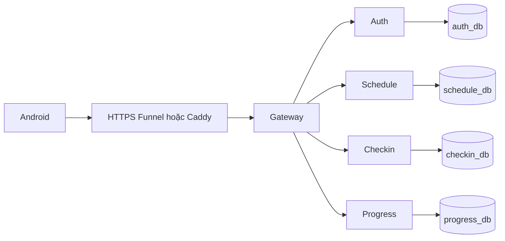

# Backend: cấu trúc và trách nhiệm tệp

Backend Java 21, Maven multi-module, Spring Boot, PostgreSQL 17 và Flyway. Một gateway chuyển yêu cầu đến bốn dịch vụ nghiệp vụ; `service-common` là thư viện chung, không phải tiến trình server. Cài đặt tại [SETUP_NEW_MACHINE.md](../docs/SETUP_NEW_MACHINE.md); contract và schema nằm ở [API](../docs/API.md), [DATA_MODEL](../docs/DATA_MODEL.md).

## Cấu trúc và đường đi dữ liệu

```text
backend/
  pom.xml                     Parent, phiên bản Java và danh sách module
  Dockerfile                  Build Maven JDK 21, chạy một SERVICE bằng JRE 21
  gateway/                    API công khai và kiểm phiên
  auth-service/               Tài khoản, hồ sơ, JWT và phiên
  schedule-service/           Ca làm, lớp và lịch buổi tập
  checkin-service/            Gói, QR và điểm danh
  progress-service/           Hành trình, mục tiêu và thông báo
  service-common/             Actor, xác thực nội bộ, lỗi, HTTP và lưu ảnh
```

Mỗi module có `pom.xml`; service có `src/main/resources/application.yml` và migration tại `src/main/resources/db/migration/`. Mỗi service nghiệp vụ sở hữu database logic riêng trong cùng PostgreSQL: `auth_db`, `schedule_db`, `checkin_db`, `progress_db`. Demo và production khác quyền database; xem [PRODUCTION.md](../docs/PRODUCTION.md).



Gateway kiểm JWT/phiên và chuẩn hóa danh tính; service nghiệp vụ vẫn kiểm quyền trên đối tượng. Lời gọi nội bộ dùng `X-Service-Key`, không đưa khóa này cho Android. Không truy vấn chéo database của service khác; dùng HTTP nội bộ. Không có transaction phân tán tự động: khi sửa luồng nhiều service phải xem cơ chế phục hồi và kiểm idempotency.

## Gateway

Đường dẫn Java: `gateway/src/main/java/vn/muaythai/gateway/`.

| Tệp | Trách nhiệm |
| --- | --- |
| `GatewayApplication.java` | Khởi động, route API, cấu hình JWT/Spring Security, route SSE riêng. |
| `SessionFilter.java` | Hỏi Auth về phiên, loại/gắn header danh tính phù hợp và xử lý lỗi phụ thuộc. |

## Auth

Đường dẫn Java: `auth-service/src/main/java/vn/muaythai/auth/`.

| Tệp | Trách nhiệm |
| --- | --- |
| `AuthApplication.java` | Điểm khởi động service. |
| `AuthApi.java` | Endpoint/DTO đăng nhập, mật khẩu và tài khoản theo contract. |
| `AuthService.java` | Quy tắc tài khoản, mật khẩu, trạng thái và xác thực. |
| `SecurityConfiguration.java` | Cấu hình bảo vệ HTTP/JWT của Auth. |
| `UserAccount.java`, `UserAccounts.java` | Entity tài khoản và repository dữ liệu tài khoản. |
| `UserSession.java`, `UserSessions.java` | Entity phiên và thao tác kiểm tra/thu hồi phiên. |
| `ProfileApi.java`, `ProfileService.java` | Endpoint và nghiệp vụ hồ sơ/danh bạ. |
| `ProfileImagesApi.java` | Endpoint avatar có kiểm quyền. |
| `TrainerDirectory.java` | Tra cứu HLV và kiểm điều kiện liên quan vòng đời HLV. |
| `InternalServices.java` | Giao tiếp/endpoint nội bộ phục vụ các service khác. |
| `DemoAccounts.java` | Seed tài khoản demo theo cấu hình; không thay cho bootstrap production. |
| `BootstrapAdmin.java` | Khởi tạo admin production khi cấu hình cho phép. |
| `ApiError.java` | Lỗi nghiệp vụ của Auth và ánh xạ phản hồi. |

## Schedule

Đường dẫn Java: `schedule-service/src/main/java/vn/muaythai/schedule/`.

| Tệp | Trách nhiệm |
| --- | --- |
| `Main.java` | Điểm khởi động service. |
| `ScheduleApi.java` | API buổi tập, lớp và lịch. |
| `ScheduleService.java` | Nghiệp vụ PT/lớp, kiểm quyền, trạng thái và điều kiện lịch. |
| `ScheduleRepository.java` | Truy vấn PostgreSQL và khóa/ràng buộc dữ liệu lịch. |
| `SessionMutations.java` | Thay đổi trạng thái buổi, phối hợp cập nhật/hủy. |
| `ParticipantsApi.java` | Endpoint danh sách và thao tác người tham gia buổi. |
| `RescheduleApi.java`, `RescheduleService.java` | Contract và nghiệp vụ yêu cầu đổi lịch/duyệt/từ chối. |
| `ShiftsApi.java`, `ShiftService.java` | Endpoint và nghiệp vụ ca làm, giờ khả dụng/đóng. |
| `ClassCalendarMaintenance.java` | Tác vụ sinh/bổ sung lịch lớp định kỳ. |
| `CalendarEvents.java`, `CalendarEventsApi.java` | Phát và phục vụ SSE cập nhật lịch theo quyền. |
| `ScheduleNotices.java` | Điều phối thông báo phát sinh từ lịch. |
| `ClassImagesApi.java` | API ảnh lớp giữ tương thích; UI hiện không dùng ảnh lớp. |

## Check-in

Đường dẫn Java: `checkin-service/src/main/java/vn/muaythai/checkin/`.

| Tệp | Trách nhiệm |
| --- | --- |
| `Main.java` | Điểm khởi động service. |
| `PackagesApi.java`, `PackageService.java` | Contract và quy tắc cấp gói/hạn/lượt/HLV/mã gói. |
| `AttendanceApi.java`, `AttendanceService.java` | Xem trước, xác nhận, thủ công, lịch sử và hoàn lượt theo quyền. |
| `AttendanceRepository.java` | Truy vấn và ghi dữ liệu điểm danh, kiểm trùng/đồng thời. |
| `AttendanceMaintenance.java` | Tác vụ bảo trì/lưu trữ lịch sử theo chính sách cấu hình. |
| `RosterApi.java` | Tra cứu danh sách và dữ liệu điểm danh phục vụ buổi tập. |
| `CareApi.java` | Danh sách chăm sóc, gói sắp hết hoặc học viên lâu chưa tập. |
| `PackageImagesApi.java` | API ảnh loại gói giữ tương thích; không còn hiển thị ảnh gói trong UI. |

## Progress

Đường dẫn Java: `progress-service/src/main/java/vn/muaythai/progress/`.

| Tệp | Trách nhiệm |
| --- | --- |
| `Main.java` | Điểm khởi động service. |
| `ProgressApi.java`, `ProgressService.java` | API và nghiệp vụ nội dung buổi, đánh giá, mục tiêu; kiểm HLV được phân công. |
| `NotificationsApi.java` | Hộp thư, đọc thông báo và tác vụ thông báo theo contract. |

## Service-common

Đường dẫn Java: `service-common/src/main/java/vn/muaythai/shared/`.

| Tệp | Trách nhiệm |
| --- | --- |
| `Actor.java` | Danh tính/quyền người gọi đã được xác minh. |
| `ServiceAccess.java` | Filter khóa dịch vụ và giải danh tính nội bộ cho controller. |
| `ServiceHttp.java` | HTTP sang service khác, timeout và truyền danh tính/khóa. |
| `Problem.java`, `ErrorResponses.java` | Kiểu lỗi và chuyển exception thành phản hồi API. |
| `ImageStore.java` | Chuẩn hóa JPEG/PNG, giới hạn ảnh và lưu/xóa/trả ảnh với cache/ETag. |

## Migration và cấu hình

Các file `V<number>__*.sql` chạy theo thứ tự Flyway. Giữ **toàn bộ migration cũ**, kể cả migration ảnh lớp/gói: database cũ cần lịch sử/checksum và API tương thích. Thêm migration mới thay vì sửa/xóa migration đã chạy.

| Service | Nhóm migration hiện có |
| --- | --- |
| Auth V1–V7 | Tài khoản/phiên, lịch sử khóa, hồ sơ, vòng đời HLV, lễ tân, cấp mật khẩu tạm, avatar. |
| Schedule V1–V8 | Lịch, ca/quy hoạch, lớp cố định, biến đổi buổi, thay HLV, SSE events, thông báo, ảnh lớp. |
| Check-in V1–V5 | Gói/điểm danh, lớp nhóm, vắng, đổi HLV gói, ảnh loại gói. |
| Progress V1–V3 | Nội dung/mục tiêu, thông báo, trạng thái mục tiêu. |

`application.yml` đọc cấu hình môi trường. Không đặt password/key thật vào YAML. [deploy/compose.yaml](../deploy/compose.yaml) là nơi nối URL/biến môi trường giữa các container. [production.compose.yaml](../deploy/production.compose.yaml) và [SQL cấp quyền](../deploy/production-sql/afterMigrate__grant_runtime.sql) tách quyền runtime/migration.

## Chạy, kiểm thử và sửa đúng chỗ

- Khuyến nghị chạy đầy đủ bằng Docker từ gốc repo theo [hướng dẫn máy mới](../docs/SETUP_NEW_MACHINE.md). Dockerfile dùng `SERVICE` để chọn JAR; không có Dockerfile riêng cho từng module.
- Muốn compile ngoài Docker: trong `backend/`, dùng JDK 21 và `mvn -B package` (Maven 3.9.x). Lệnh package không thay thế kiểm thử tích hợp database/HTTP.
- Kiểm thử hiện hành là [tests/acceptance.mjs](../tests/acceptance.mjs), [tests/images.mjs](../tests/images.mjs) và [tests/production-smoke.ps1](../tests/production-smoke.ps1). Chưa có bộ JUnit/Testcontainers hay Spotless được cấu hình trong POM hiện tại; không coi công cụ từng được đề xuất là đã tích hợp.
- Thêm endpoint: cập nhật DTO/validation → service kiểm quyền/quy tắc → repository/migration nếu cần → contract → kiểm thử happy path/quyền sai/xung đột. Kiểm tra route gateway khi thêm nhóm đường dẫn.
- Lỗi trạng thái lịch: xem Schedule; lỗi trừ lượt/check-in: xem Check-in; phiên/mật khẩu: xem Auth; mục tiêu/đánh giá: xem Progress. Không chữa lỗi bằng cách bỏ filter hoặc trả thành công giả.
- Bằng chứng bàn giao mới nhất ở [PROGRESS.md](../PROGRESS.md); SonarQube/coverage là lần đo cụ thể, không tự động bảo đảm mọi commit mới đều đã quét.
