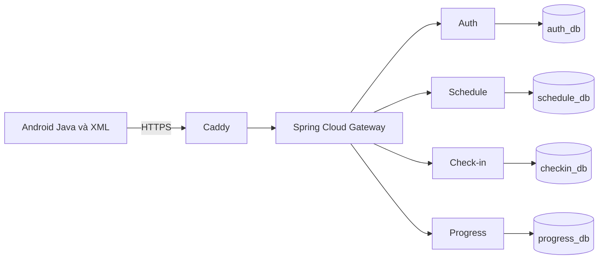

# Kiến trúc và công nghệ

Bản đầu dùng một app Android, một API gateway và bốn service nghiệp vụ. Caddy, PostgreSQL và gateway có vai trò hạ tầng. Mỗi service sở hữu database logic của mình trong cùng một máy PostgreSQL. Android gọi một địa chỉ gateway. Các service trao đổi qua REST nội bộ khi cần dữ liệu thuộc service khác.



## Quyền sở hữu nghiệp vụ

| Service | Sở hữu và chịu trách nhiệm |
| --- | --- |
| Auth | Tài khoản, hồ sơ, vai trò, quyền điều chỉnh điểm danh, phiên và khóa tài khoản. |
| Schedule | Lịch PT, lớp 30, lịch lặp và buổi tập. Giữ lịch, chống trùng HLV và học viên, kiểm quyền duyệt/hủy. |
| Check-in | Gói tập, mã QR, lượt điểm danh, lần hoàn buổi. Kiểm số lượt và sức chứa check-in lớp 30. |
| Progress | Nội dung buổi, nhận xét và đánh giá. Tra Schedule để kiểm người phụ trách và đối tượng được xem. |

Schedule gọi Check-in khi xác minh gói dùng để đặt PT. Check-in gọi Schedule để kiểm buổi và gói mong đợi. Các lệnh kiểm tra này có timeout rõ ràng. Transaction ghi giữ trong database của service sở hữu. API nội bộ không được định tuyến ra ngoài qua gateway. Service sở hữu nghiệp vụ kiểm quyền trên bản ghi và trả lỗi phù hợp khi dữ liệu xung đột.

## Cấu trúc thư mục dự kiến

```text
android/                         App Java, XML và Android resources
backend/
  gateway/                       Định tuyến, xác thực, truyền danh tính
  auth-service/
  schedule-service/
  checkin-service/
  progress-service/
deploy/                          Docker Compose, Caddy, cấu hình triển khai
docs/                            Đặc tả, prototype và tài liệu triển khai
```

Dockerfile nằm cùng mã nguồn của service được đóng gói. Trong Android dùng Fragment và ViewBinding cho UI, ViewModel cho trạng thái, Repository cho Retrofit. Trong backend, controller nhận DTO, lớp service giữ quy tắc và phạm vi transaction, repository truy cập PostgreSQL. Dùng tên theo hành động nghiệp vụ như `confirmCheckIn`, `reverseAttendance` và `cancelBooking`. Ưu tiên hàm ngắn với một trách nhiệm rõ và chỉ tách helper khi có lợi cho việc đọc hoặc dùng lại.

## Công cụ được duyệt

| Nhóm | Lựa chọn | Cách dùng |
| --- | --- | --- |
| UI Android | Java, XML, AndroidX, ViewBinding, Material Components | Form, tab, danh sách, hộp thoại và bottom sheet. Bố cục theo HTML Tối giản. |
| Icon | Remix Icon | SVG cần dùng được chuyển thành VectorDrawable. |
| HTTP Android | Retrofit + OkHttp | API interface, timeout và interceptor dùng chung. |
| QR | ZXing Android Embedded và ZXing Core | Màn camera và QR của gói. Kiểm tra trên thiết bị thật với minSdk 24. |
| Backend | Java 21, Maven, Spring Boot, Spring Security, Spring Cloud Gateway | REST, validation, JWT, mật khẩu và định tuyến. Tạo khung bằng Spring Initializr. |
| Database | PostgreSQL 17, Spring Data JPA, Flyway | Repository, migration theo service và ràng buộc dữ liệu. |
| Kiểm thử | JUnit + Testcontainers Java | PostgreSQL thật cho test trùng lịch, điểm danh đồng thời và hoàn lượt. |
| Format | Spotless + Google Java Format | Gradle cho app và Maven cho backend. Plugin chạy trong quy trình phát triển. |
| Triển khai | Docker Compose và Caddy | Mạng nội bộ, volume, healthcheck và HTTPS. |

GymTrim, Etar và Material Catalog là nguồn xem bố cục hoặc component. Bản HTML Tối giản chốt hình ảnh. Petclinic và Docker Awesome Compose là mẫu đối chiếu định tuyến và cấu hình. Kizitonwose Calendar được cân nhắc khi tới lưới tuần tùy biến, sau khi thử từ Java với minSdk 24.

### Repo tham chiếu

- [Material Components Android](https://github.com/material-components/material-components-android) · [GymTrim](https://github.com/naibaf-1/GymTrim) · [Etar](https://github.com/Etar-Group/Etar-Calendar) · [Kizitonwose Calendar](https://github.com/kizitonwose/Calendar)
- [Remix Icon và giấy phép](https://github.com/Remix-Design/RemixIcon/blob/master/License) · [Retrofit](https://github.com/lysine-dev/retrofit) · [OkHttp](https://github.com/lysine-dev/okhttp) · [ZXing Android Embedded](https://github.com/journeyapps/zxing-android-embedded)
- [Spring Initializr](https://github.com/spring-io/initializr) · [Spring Security](https://github.com/spring-projects/spring-security) · [Spring Cloud Gateway](https://github.com/spring-cloud/spring-cloud-gateway) · [Spring Data JPA](https://github.com/spring-projects/spring-data-jpa) · [Flyway](https://github.com/flyway/flyway)
- [Spotless](https://github.com/diffplug/spotless) · [Google Java Format](https://github.com/google/google-java-format) · [Testcontainers](https://github.com/testcontainers/testcontainers-java)
- [Spring Boot Docker](https://github.com/spring-guides/gs-spring-boot-docker) · [Docker Awesome Compose](https://github.com/docker/awesome-compose/tree/master/spring-postgres) · [Petclinic](https://github.com/spring-petclinic/spring-petclinic-microservices)

## Xác thực và cấu hình chạy

Gateway kiểm chữ ký và hạn JWT. Với đường dẫn được bảo vệ, gateway hỏi Auth về tài khoản và phiên trước khi định tuyến. Auth kiểm trạng thái tài khoản, phiên bị thu hồi và cờ đổi mật khẩu bắt buộc. Khóa tài khoản vô hiệu phiên đang có. Mở khóa yêu cầu đăng nhập lại. Đăng xuất thu hồi phiên hiện tại. Service kiểm role và quyền trên đối tượng cụ thể.

Gateway loại bỏ header danh tính do client gửi và gắn danh tính từ phiên đã xác thực vào yêu cầu nội bộ. Các lời gọi trực tiếp giữa service dùng xác thực nội bộ và được kiểm tại điểm nhận. Cấu hình được truyền qua biến môi trường hoặc secret khi chạy. Cổng database và service chỉ dùng trong mạng Docker khi chạy demo qua Caddy. Healthcheck và log lỗi có mã yêu cầu để dò theo luồng, bỏ qua JWT, mật khẩu và mã QR đầy đủ.

[Phạm vi](SCOPE.md) · [API](API.md) · [Mô hình dữ liệu](DATA_MODEL.md)
