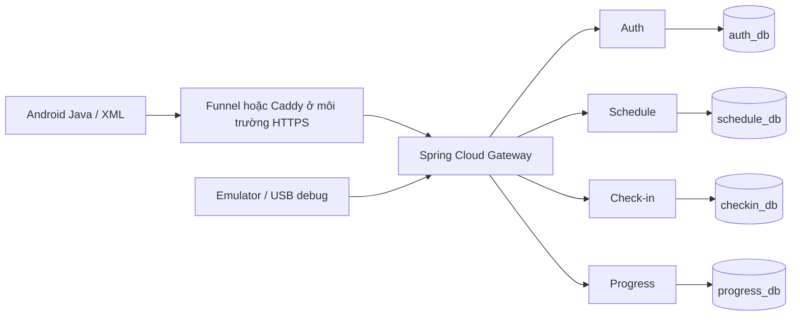

# Kiến trúc và công nghệ hiện hành

Đối chiếu mã nguồn tại bản 0.1.7. Không coi danh sách công cụ từng được đề xuất là công cụ đã tích hợp.

## Các lớp hệ thống

Demo Compose chỉ xuất gateway ở loopback, không tự chạy Caddy hay Funnel. Production Compose bổ sung phân quyền database; reverse proxy HTTPS vẫn cần cấu hình riêng. Bốn database logic nằm trong một PostgreSQL instance, không phải bốn cụm PostgreSQL độc lập.

## Công nghệ được dùng trong mã

| Phần | Hiện trạng / nguồn cấu hình |
| --- | --- |
| Android | Java 17, minSdk 24, compile/target SDK 36; AndroidX, ViewBinding, Material, Retrofit/OkHttp, Gson, Glide, ZXing. [Gradle](../android/app/build.gradle). |
| UI | LoginActivity + ViewModel/Repository; WorkspaceActivity + Pane dựng widget Java và XML khung. Không dùng Fragment cho từng tab. Remix Icon vector và màu theo vai trò. |
| Backend | Java 21, Maven multi-module, Spring Boot 3.5.14, Spring Security, Spring Cloud Gateway. [Parent POM](../backend/pom.xml), POM từng module. |
| Dữ liệu | PostgreSQL 17, Flyway; Auth có JPA/entity/repository, nghiệp vụ khác chủ yếu JDBC theo module. |
| Đóng gói | Một [Dockerfile backend](../backend/Dockerfile) chọn JAR bằng SERVICE; Compose chạy DB, init, gateway và bốn dịch vụ. |
| Kiểm thử | Node.js 24 cho API/ảnh, PowerShell cho emulator và production smoke, Android lint. [Workflow](../.github/workflows/verify.yaml). |
| Chất lượng | JaCoCo qua script coverage và SonarQube chạy riêng. Chưa có Spotless/JUnit/Testcontainers được cấu hình trong build hiện tại. |
| Cập nhật app | GitHub Releases, DownloadManager, FileProvider, kiểm APK và trình cài đặt Android. |

## Quyền sở hữu và transaction

- **Auth:** tài khoản, hồ sơ/avatar, vai trò, mật khẩu, JWT và phiên bị thu hồi.
- **Schedule:** ca làm, PT, lớp nhóm, đăng ký, lịch lặp, đổi/hủy và SSE.
- **Check-in:** gói, mã QR, lượt, điểm danh, hoàn lượt và chăm sóc.
- **Progress:** nội dung buổi, đánh giá, mục tiêu và thông báo.

Service gọi HTTP nội bộ khi cần dữ liệu của nhau; mỗi transaction chỉ bao phủ database của service sở hữu. Không có distributed transaction tự động. Các luồng hủy/điểm danh cần kiểm thử phục hồi và idempotency riêng.

Gateway kiểm JWT và phiên, loại header do client tự gắn rồi truyền danh tính đã xác minh. Các service kiểm khóa nội bộ và quyền trên bản ghi. Không expose endpoint nội bộ hoặc khóa X-Service-Key cho app. Biến môi trường được nối qua Compose; secret thật chỉ nằm trong môi trường triển khai.

## Cấu trúc và quy tắc mã

- [Frontend: từng tệp và luồng chạy](../android/README.md).
- [Backend: từng module/tệp, migration và cấu hình](../backend/README.md).
- [API](API.md), [dữ liệu](DATA_MODEL.md), [phạm vi](SCOPE.md), [sitemap](UI.md).

UI không quyết định quyền nghiệp vụ. Controller nhận/validate dữ liệu; service kiểm quy tắc và quyền, repository thực hiện truy vấn/khóa; migration giữ ràng buộc database. Không sửa migration đã chạy. Ưu tiên hàm có một trách nhiệm, giảm lặp có ích; chưa có formatter tự động không có nghĩa bỏ review diff.

## Giới hạn cần hiểu

SSE đồng bộ khi app mở lịch; không thay cho push notification nền. Phiên workspace nằm trong tiến trình Android. APK GitHub đang ký debug và trỏ endpoint lúc build; cài máy mới không tự chuyển server hay khóa ký. Cơ chế production và phạm vi chưa nghiệm thu nằm ở [PRODUCTION.md](PRODUCTION.md) và [PROGRESS.md](../PROGRESS.md).
