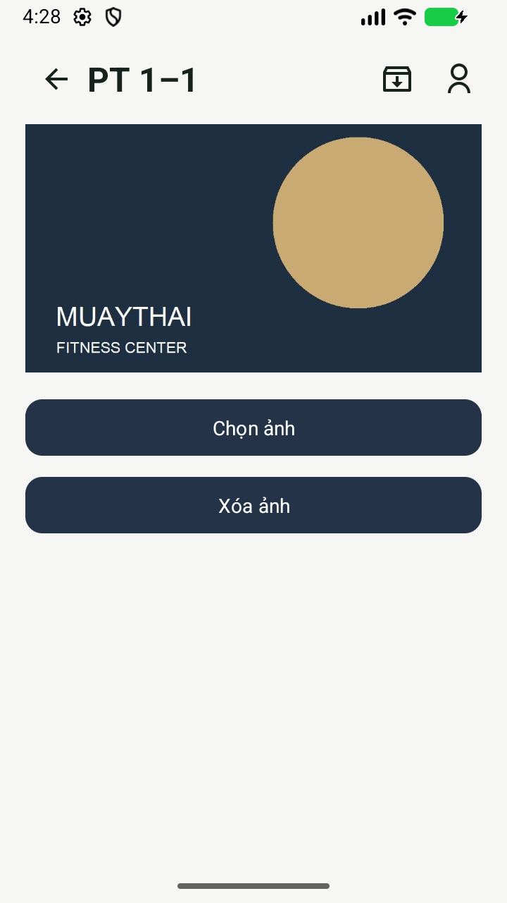
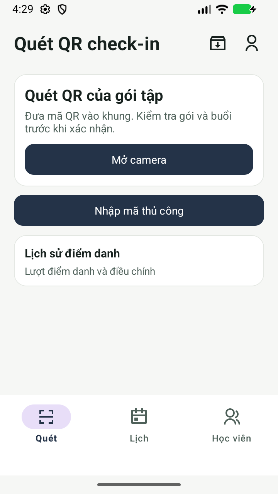
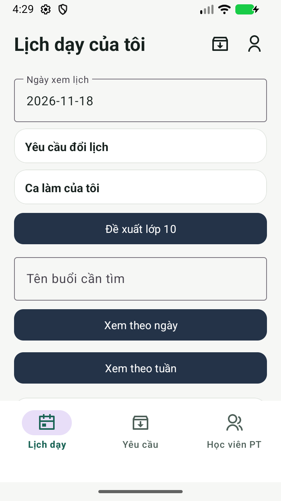
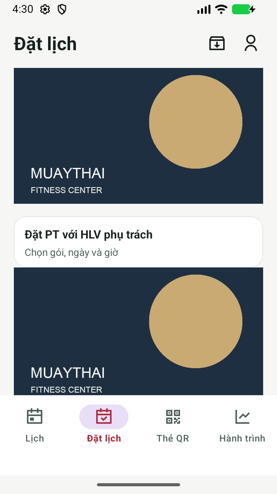

# Giao diện theo vai trò

Bộ ảnh lịch sử của bản 0.1.2. Từ bản 0.1.4, ảnh lớp/gói đã bỏ khỏi giao diện và các thao tác phụ dùng icon. Xem [giao diện hiện tại](UI_UPDATE_0.1.4.md).

Bộ chụp ngày 18/11/2026 từ APK Java chạy trên Android Emulator, màn hình 720 × 1280, kết nối database QA riêng. Có 30 ảnh, được chia theo bốn vai trò. Đây là các màn hình chính và luồng cập nhật ảnh, chưa phải toàn bộ biểu mẫu và trạng thái lỗi của ứng dụng.

Ảnh khóa học và avatar là dữ liệu minh họa tự tạo phục vụ kiểm thử. Tài khoản trong ảnh dùng địa chỉ `example.test`, không phải hồ sơ hội viên thật. Người quản trị có thể thay bằng ảnh của trung tâm trong ứng dụng.

## 1. Quản trị viên — ADMIN

| Màn hình | Ảnh |
| --- | --- |
| Đăng nhập | [Xem](screenshots/2026-11-18/admin/login.png) |
| Quét QR | [Xem](screenshots/2026-11-18/admin/scan.png) |
| Lịch | [Xem](screenshots/2026-11-18/admin/calendar.png) |
| Học viên | [Xem](screenshots/2026-11-18/admin/learners.png) |
| Quản lý | [Xem](screenshots/2026-11-18/admin/management.png) |
| Danh sách loại gói | [Xem](screenshots/2026-11-18/admin/package-image-types.png) |
| Sửa ảnh loại gói | [Xem](screenshots/2026-11-18/admin/package-image-editor.png) |
| Sửa ảnh lớp | [Xem](screenshots/2026-11-18/admin/class-image-editor.png) |
| Hồ sơ | [Xem](screenshots/2026-11-18/admin/profile.png) |
| Xem trước avatar | [Xem](screenshots/2026-11-18/admin/profile-image-preview.png) |
| Avatar sau khi lưu | [Xem](screenshots/2026-11-18/admin/profile-image-saved.png) |

## 2. Lễ tân — RECEPTION

| Màn hình | Ảnh |
| --- | --- |
| Quét QR tại quầy | [Xem](screenshots/2026-11-18/reception/scan.png) |
| Lịch | [Xem](screenshots/2026-11-18/reception/calendar.png) |
| Tra học viên | [Xem](screenshots/2026-11-18/reception/learners.png) |
| Hồ sơ | [Xem](screenshots/2026-11-18/reception/profile.png) |
| Xem trước avatar | [Xem](screenshots/2026-11-18/reception/profile-image-preview.png) |
| Avatar sau khi lưu | [Xem](screenshots/2026-11-18/reception/profile-image-saved.png) |

## 3. Huấn luyện viên — TRAINER

| Màn hình | Ảnh |
| --- | --- |
| Lịch dạy | [Xem](screenshots/2026-11-18/trainer/teaching-calendar.png) |
| Yêu cầu | [Xem](screenshots/2026-11-18/trainer/requests.png) |
| Học viên PT | [Xem](screenshots/2026-11-18/trainer/pt-learners.png) |
| Hồ sơ | [Xem](screenshots/2026-11-18/trainer/profile.png) |
| Xem trước avatar | [Xem](screenshots/2026-11-18/trainer/profile-image-preview.png) |
| Avatar sau khi lưu | [Xem](screenshots/2026-11-18/trainer/profile-image-saved.png) |

## 4. Học viên — LEARNER

| Màn hình | Ảnh |
| --- | --- |
| Lịch tập | [Xem](screenshots/2026-11-18/learner/calendar.png) |
| Đặt lịch có ảnh gói | [Xem](screenshots/2026-11-18/learner/booking.png) |
| Thẻ QR có ảnh gói | [Xem](screenshots/2026-11-18/learner/qr-cards.png) |
| Hành trình | [Xem](screenshots/2026-11-18/learner/journey.png) |
| Hồ sơ | [Xem](screenshots/2026-11-18/learner/profile.png) |
| Xem trước avatar | [Xem](screenshots/2026-11-18/learner/profile-image-preview.png) |
| Avatar sau khi lưu | [Xem](screenshots/2026-11-18/learner/profile-image-saved.png) |

## 5. Cách thay ảnh

- Mọi vai trò mở biểu tượng tài khoản → Chọn ảnh → chọn trong Android Photo Picker → xem trước → Lưu ảnh. Xóa ảnh có xác nhận.
- Quản trị viên mở Quản lý → Ảnh loại gói để sửa PT, lớp 10, lớp 30 hoặc tập tự do.
- Quản trị viên mở Quản lý → Lớp nhóm → chi tiết lớp để sửa ảnh riêng của lớp.
- Lớp chưa có ảnh riêng sẽ dùng ảnh loại gói tương ứng. Chưa có cả hai sẽ hiển thị biểu tượng Remix Icon.

Xem [hợp đồng API](IMAGE_API.md) và [báo cáo kiểm thử](QA_IMAGES_2026-11-18.md).
