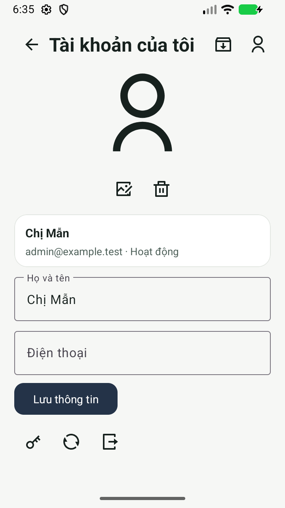
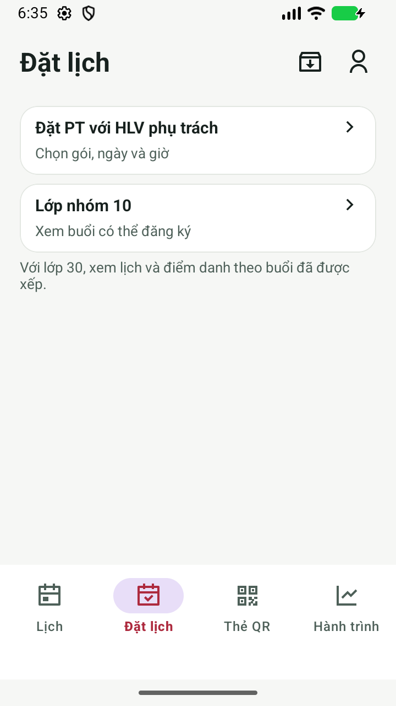

# Giao diện và kết nối — 0.1.4

> Báo cáo lịch sử. Ảnh cũ được tham chiếu cố định từ tag v0.1.7; bố cục hiện hành xem [UI_REDESIGN_0.1.5.md](UI_REDESIGN_0.1.5.md), thay đổi cập nhật xem [IN_APP_UPDATE.md](IN_APP_UPDATE.md).

## Phạm vi

- Bỏ ảnh loại gói và ảnh từng lớp khỏi giao diện, màn đặt lịch và thẻ QR. Không còn mục quản lý ảnh loại gói.
- Giữ ảnh đại diện cá nhân. Chọn/xóa ảnh dùng hai icon cạnh nhau.
- Các thao tác phụ dùng Remix Icon có mô tả cho TalkBack và tooltip khi nhấn giữ, vùng chạm 48 × 48 dp. Nút lưu và xác nhận giữ nhãn, được thu gọn theo nội dung.
- Danh sách dùng mũi tên chỉ hướng cho mục có thể mở. Icon lấy từ Remix Icon, giữ nguồn và giấy phép trong [android/third-party](../android/third-party/README.md).

API và dữ liệu ảnh cũ vẫn được giữ để tương thích APK đã phát hành. Bản mới không tải ảnh lớp/gói; thay đổi không xóa dữ liệu máy chủ.

## Thông báo kết nối

Màn đăng nhập và workspace dùng chung observer theo vòng đời resume/pause. Khi chưa có Internet, app hiện cảnh báo có nút mở cài đặt mạng. Khi Internet trở lại, cảnh báo được thay bằng thông báo ngắn. Mất mạng không tự đăng xuất, không tự gửi lại yêu cầu ghi và không làm mới biểu mẫu đang nhập.

Trạng thái Internet dựa trên callback mạng mặc định và khả năng INTERNET + VALIDATED của Android. Đây không phải kiểm tra sức khỏe backend. Khi máy chủ lỗi nhưng điện thoại còn Internet, lỗi yêu cầu được xử lý riêng. [Tài liệu Android](https://developer.android.com/develop/connectivity/network-ops/reading-network-state).

## Kiểm thử

[Script kiểm thử mạng](../tests/connectivity.ps1) chỉ chạy trên emulator, có khôi phục trạng thái Wi-Fi/dữ liệu di động trong finally. Script kiểm cold start offline, giữ nội dung nhập khi nối lại, workspace, nút cài đặt và quay về từ nền. Đăng nhập dùng tài khoản demo hiện có, không ghi hồ sơ nghiệp vụ.

Observer đăng ký khi resume và hủy khi pause để đọc lại trạng thái khi app hoạt động trở lại từ cài đặt hoặc cửa sổ khác.

Các ca cold start offline, giữ nội dung nhập, workspace, trở về từ cài đặt, giữ phiên khi nối lại và trở về từ Recents đều đã chạy đạt trên emulator. Android build/lint đạt, 0 lỗi và 11 cảnh báo hiện hữu. Hai APK có versionName 0.1.4, versionCode 5 và giữ chữ ký debug cũ.

Các ca điện thoại thật, VPN, Wi-Fi có captive portal và chuyển Wi-Fi/4G còn cần nghiệm thu riêng.
## Ảnh giao diện

Bộ ảnh chụp từ emulator 720 × 1280 với tài khoản demo, không phải hồ sơ hội viên thật. Đây là các màn đại diện của thay đổi; bộ ảnh bốn vai trò của 0.1.2 được giữ làm lịch sử.

| Nhóm | Ảnh |
| --- | --- |
| Mạng | [Đăng nhập offline](https://github.com/emHung/MuayThai_Fitness-Center/blob/v0.1.7/docs/screenshots/0.1.4/login-offline.png), [đăng nhập nối lại](https://github.com/emHung/MuayThai_Fitness-Center/blob/v0.1.7/docs/screenshots/0.1.4/login-online.png), [workspace offline](https://github.com/emHung/MuayThai_Fitness-Center/blob/v0.1.7/docs/screenshots/0.1.4/workspace-offline.png), [Internet trở lại](https://github.com/emHung/MuayThai_Fitness-Center/blob/v0.1.7/docs/screenshots/0.1.4/workspace-online.png) |
| Quản trị viên | [Quét QR](https://github.com/emHung/MuayThai_Fitness-Center/blob/v0.1.7/docs/screenshots/0.1.4/admin-scan.png), [lịch](https://github.com/emHung/MuayThai_Fitness-Center/blob/v0.1.7/docs/screenshots/0.1.4/admin-calendar.png), [quản lý](https://github.com/emHung/MuayThai_Fitness-Center/blob/v0.1.7/docs/screenshots/0.1.4/admin-management.png), [tài khoản](https://github.com/emHung/MuayThai_Fitness-Center/blob/v0.1.7/docs/screenshots/0.1.4/admin-profile.png) |
| Học viên | [Đặt lịch](https://github.com/emHung/MuayThai_Fitness-Center/blob/v0.1.7/docs/screenshots/0.1.4/learner-booking.png), [thẻ tập](https://github.com/emHung/MuayThai_Fitness-Center/blob/v0.1.7/docs/screenshots/0.1.4/learner-qr.png), [tài khoản](https://github.com/emHung/MuayThai_Fitness-Center/blob/v0.1.7/docs/screenshots/0.1.4/learner-profile.png) |

